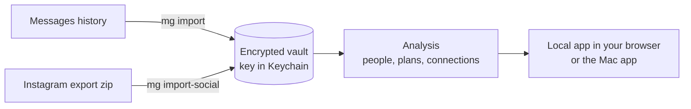

# Messaging Graph

A private app for your Mac that reads your Messages history and helps you keep up with the
people in it: who you've drifted from, plans that never got a date, messages worth sending, and
how your friends connect to each other. It runs entirely on your computer.

**[Instructions →](docs/INSTRUCTIONS.md)** · [File structure](docs/FILE-STRUCTURE.md) · [How it works](docs/how-it-works.md)
