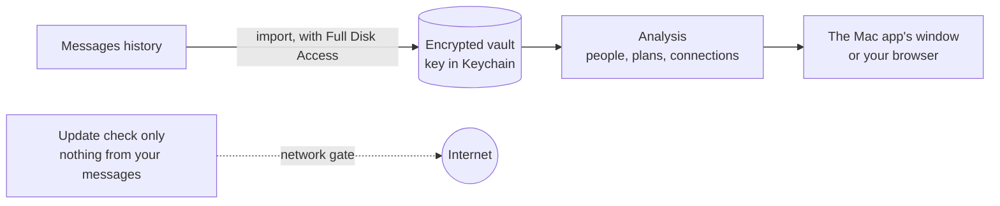

# Messaging Graph

A Mac app that reads your Messages history and helps you keep up with the people in it: who
you've drifted from, plans that never got a date, messages worth sending, and how your friends
connect. Everything runs on your Mac; nothing from your messages leaves it. Free, with nothing
locked.

**[Download Messaging Graph](https://github.com/amalmehta/MessagingGraph/releases/latest/download/Messaging-Graph.zip)** (macOS 13 or later; built for Intel, and runs on Apple silicon through Rosetta, which macOS offers to install). Unzip it and drag Messaging Graph to Applications. It isn't notarized yet, so the first time, right-click it and choose **Open**. It then asks for Full Disk Access, which it needs to read your Messages history.

**[Instructions →](docs/INSTRUCTIONS.md)** · [System design](docs/SYSTEM-DESIGN.md) · [File structure](docs/FILE-STRUCTURE.md) · [How it works](docs/how-it-works.md) · [Go-live, for a paid Pro version later](docs/GO-LIVE.md)
