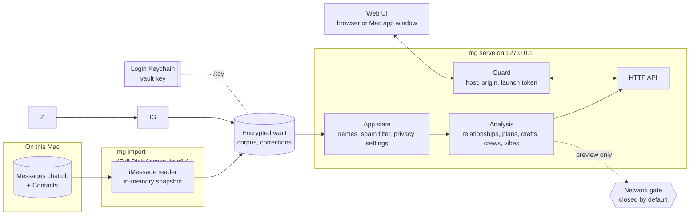

# System design

How Messaging Graph is put together. Back to the [README](../README.md) · [Instructions](INSTRUCTIONS.md) · [File structure](FILE-STRUCTURE.md)

## Overview

Messaging Graph reads your Messages history once, seals it into an encrypted vault, and serves a local web app
that analyses it: relationships, plans, drafts worth sending and who's connected. A short import holds Full Disk
Access; the server that answers the browser (or the Mac app's window) only ever reads the vault. The reasoning
behind what it measures, and what it refuses to do, is in [How it works](how-it-works.md).



## Components

| Part | What it does | Where |
|---|---|---|
| **CLI** | `import`, `serve`, `doctor`, `wipe`, `build-app`. Prints counts and settings only, never names or text. | `mg`, `app/cli.py` |
| **Sources** | One seam, `load_source`: the synthetic demo, the vault, or a specific `chat.db` copy for tests. Analysis only ever sees the `Corpus` type. | `app/ingest/base.py`, `app/models.py` |
| **iMessage reader** | Snapshots `chat.db` into memory, decodes `attributedBody`, folds tapbacks into reactions, merges handles, drops machine senders, gives everything keyed-hash ids. | `app/ingest/imessage.py`, `contacts.py` |
| **Vault** | Encrypts and stores the corpus and small sealed documents; derives the stable id key. | `app/vault.py` |
| **App state** | Loads one corpus, applies your names and filter verdicts, sets aside automated threads, applies privacy settings, then runs every analysis. Re-runs on any change. | `app/state.py` |
| **Analysis** | Relationships, plans, drafts in your voice, thank-yous, crews, connections, places, vibes, spam filtering, rate series. | `app/analysis/` |
| **Privacy** | Exclusions, retention, redaction, and the network gate with its audit log. | `app/privacy.py` |
| **Guard** | Localhost hardening in front of every request. | `app/security.py` |
| **API + UI** | FastAPI routes; a dependency-free HTML/CSS/JS front end with a hand-rolled force layout. | `app/main.py`, `app/static/` |
| **Mac app** | A native window and menu bar item around the same server; hands imports to Terminal. | `app/desktop.py`, `macapp/` |

## Main flows

**Import, then serve**

```mermaid
sequenceDiagram
    actor You
    participant CLI as mg import
    participant Reader as iMessage reader
    participant Vault
    participant Keychain
    participant Server as mg serve
    participant Browser
    You->>CLI: run with Full Disk Access on
    CLI->>Vault: id key (creates vault key if none)
    Vault->>Keychain: get / store key
    CLI->>Reader: load(days)
    Reader->>Reader: snapshot chat.db + Contacts into memory
    Reader-->>CLI: corpus + counts
    CLI->>Vault: encrypt and write corpus + manifest
    CLI-->>You: counts only; turn Full Disk Access off
    You->>Server: mg serve
    Server->>Vault: decrypt corpus
    Server->>Server: names, spam filter, settings, analysis
    Server-->>You: one-time launch link
    You->>Browser: open link
    Browser->>Server: ?token= swapped for session cookie
    Server-->>Browser: app, every request through the Guard
```

**Corrections.** Naming someone, restoring or hiding a filtered thread, or a location
is a POST that saves an overrides document into the vault and recomputes state. Because ids are keyed hashes
derived from the vault key, corrections survive a fresh import.

**Mac app.** The app never reads `chat.db`. If the project folder is still where it was built, it starts
`mg serve` with the project's own Python (which the Keychain already trusts) on a free port and shows the
launch link in a WebKit window; otherwise it serves in-process.

## Data and storage

| Data | Where | Notes |
|---|---|---|
| Imported corpus | `~/Library/Application Support/messaging-graph/corpus.v1.enc` | Compressed JSON, Fernet-encrypted. Written atomically to a `0600` file; plaintext never touches disk. |
| Vault key | Login Keychain | Random, created on first import. Refuses to fall back to any non-macOS keyring. Also seeds the HMAC id key. |
| Corrections | `overrides.v1.enc` beside the corpus | Sealed with the same key. In memory only for the demo. |
| Manifest | `manifest.json` beside the corpus | Counts, window and import time; no content. |
| Vault folder | Same folder | `0700`, excluded from Spotlight and Time Machine; `mg wipe` removes it and the key. |
| Privacy settings, audit log | Server memory | Reset when the server restarts. |

## Design decisions

- **Import once, serve without access.** Full Disk Access is needed only for the minutes `mg import` runs;
  the cost is that data is only as fresh as the last import.
- **Snapshot, not a live read.** SQLite's backup API copies the store into memory through the write-ahead log,
  so the newest messages are included and nothing is written back.
- **Key in the Keychain, not beside the data.** A copied vault file is useless on its own. It doesn't help
  against malware running as you, which can ask the Keychain too.
- **Keyed-hash ids.** No phone number or email appears in an id, URL or log, and ids stay stable across imports.
- **Localhost is not a boundary.** Host allowlist, Origin checks, a `SameSite=Strict` cookie, a one-time
  launch token and a strict Content-Security-Policy, because any web page can reach 127.0.0.1.
- **One network chokepoint.** Anything leaving must pass the gate, which is closed by default and returns the
  redacted text to send. Drafting is local and template-based in your voice; the Claude call exists only as
  a gated seam and a payload preview.
- **Recompute everything.** Corrections and settings rebuild all analysis rather than patching it; simple and
  consistent, fine at the size of one person's history.

## Testing

There's no unit-test suite. `validate.py` runs a long list of named pass/fail checks: the analysis recovers the synthetic
generator's hidden parameters, tone rules, plans, drafts, crews, the rate series and history paging,
the vault round trip, localhost hardening, privacy enforcement and theme contrast. `tests/chatdb_fixture.py`
builds a small `chat.db` shaped like the real one, including write-ahead-log rows, `attributedBody`, tapbacks
and hostile names, for the import checks. The Mac app isn't tested.

## Limits

- macOS only, and the language analysis is English only.
- Data is as fresh as the last `mg import`; the server doesn't watch `chat.db`.
- Privacy settings and the audit log aren't saved, so exclusions reset on restart.
- The network path (Claude drafting) is not wired into the UI beyond a preview.
- Nothing protects against malware running as you or an unlocked Mac; FileVault covers a lost one.
