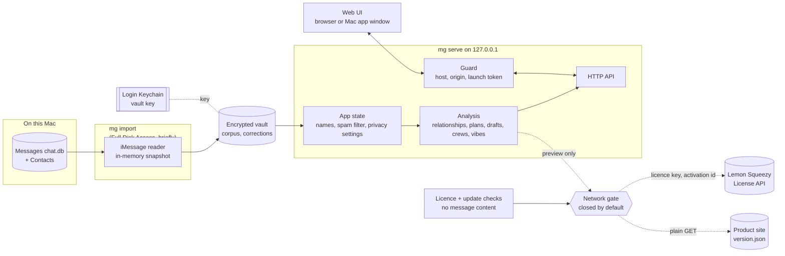
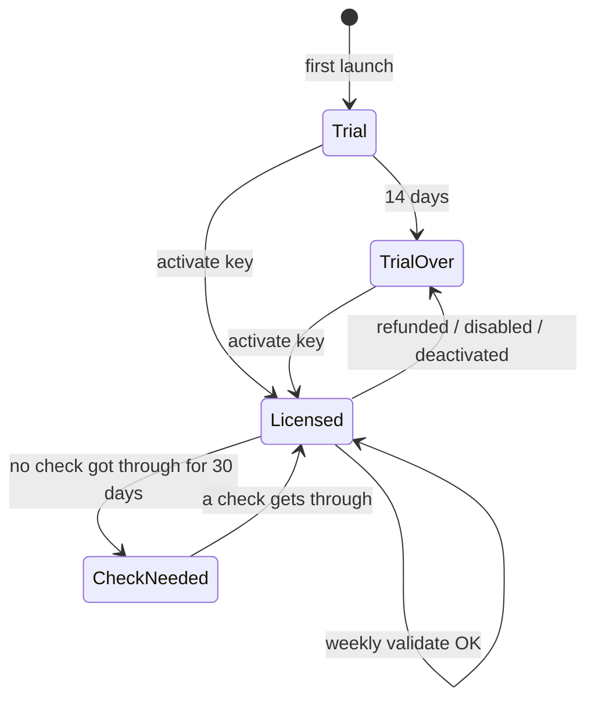

# System design

How Messaging Graph is put together. Back to the [README](../README.md) · [Instructions](INSTRUCTIONS.md) · [File structure](FILE-STRUCTURE.md) · [Go-live](GO-LIVE.md)

## Overview

Messaging Graph reads your Messages history once, seals it into an encrypted vault, and serves a local web app
that analyses it: relationships, plans, drafts worth sending and who's connected. Only the import reads `chat.db`;
the server that answers the browser (or the Mac app's window) only ever reads the vault. It ships directly as a
signed, notarized Mac app, free for everyone (`product.FREE`). The 14-day trial and one-time licence are kept,
switched off, for a paid Pro version later; the update check (and, once paid, the licence check) are the only
things that ever go online, and neither carries message content. The reasoning behind what it measures, and
what it refuses to do, is in [How it works](how-it-works.md).



## Components

| Part | What it does | Where |
|---|---|---|
| **CLI** | `import`, `serve`, `doctor`, `wipe`, `licence`, `build-app`. Prints counts and settings only, never names or text. | `mg`, `app/cli.py` |
| **Sources** | One seam, `load_source`: the synthetic demo, the vault, or a specific `chat.db` copy for tests. Analysis only ever sees the `Corpus` type. | `app/ingest/base.py`, `app/models.py` |
| **iMessage reader** | Snapshots `chat.db` into memory, decodes `attributedBody`, folds tapbacks into reactions, merges handles, drops machine senders, gives everything keyed-hash ids. | `app/ingest/imessage.py`, `contacts.py` |
| **Vault** | Encrypts and stores the corpus and small sealed documents; derives the stable id key. | `app/vault.py` |
| **App state** | Loads one corpus, applies your names and filter verdicts, sets aside automated threads, applies privacy settings, then runs every analysis. Re-runs on any change. | `app/state.py` |
| **Analysis** | Relationships, plans, drafts in your voice, thank-yous, crews, connections, places, vibes, spam filtering, rate series. | `app/analysis/` |
| **Privacy** | Exclusions, retention, redaction, and the network gate with its audit log. | `app/privacy.py` |
| **Product** | The one place for price, trial, version, bundle id, store ids and URLs. | `app/product.py` |
| **Licence** | Trial clock, Lemon Squeezy activate / validate / deactivate, offline grace, the import gate. | `app/licence.py`, `app/appdata.py` |
| **Updates** | A weekly GET of `version.json` from the product site; says "newer version", never downloads. | `app/updates.py` |
| **Onboarding** | The first-run screen: detects Full Disk Access, explains it, deep-links to Settings, re-checks. | `app/onboarding.py` |
| **Guard** | Localhost hardening in front of every request. | `app/security.py` |
| **API + UI** | FastAPI routes; a dependency-free HTML/CSS/JS front end with a hand-rolled force layout. | `app/main.py`, `app/static/` |
| **Mac app** | A native window and menu bar item around the same server; imports in-process, so Full Disk Access belongs to the app. | `app/desktop.py`, `macapp/` |
| **Packaging** | Builds the `.app` (PyInstaller, bundled Python), signs it inside out with the hardened runtime, notarizes, makes the DMG. | `scripts/package.sh`, `macapp/build.py`, `macapp/entitlements.plist` |
| **Product site** | Landing page with price and Buy button, privacy policy, terms and refund templates, `version.json`. | `site/` |

## Main flows

**Import, then serve**

```mermaid
sequenceDiagram
    actor You
    participant CLI as mg import
    participant Reader as iMessage reader
    participant Vault
    participant Keychain
    participant Server as mg serve
    participant Browser
    You->>CLI: run with Full Disk Access on
    CLI->>Vault: id key (creates vault key if none)
    Vault->>Keychain: get / store key
    CLI->>Reader: load(days)
    Reader->>Reader: snapshot chat.db + Contacts into memory
    Reader-->>CLI: corpus + counts
    CLI->>Vault: encrypt and write corpus + manifest
    CLI-->>You: counts only; turn Full Disk Access off
    You->>Server: mg serve
    Server->>Vault: decrypt corpus
    Server->>Server: names, spam filter, settings, analysis
    Server-->>You: one-time launch link
    You->>Browser: open link
    Browser->>Server: ?token= swapped for session cookie
    Server-->>Browser: app, every request through the Guard
```

**Corrections.** Naming someone, restoring or hiding a filtered thread, or a location
is a POST that saves an overrides document into the vault and recomputes state. Because ids are keyed hashes
derived from the vault key, corrections survive a fresh import.

**This week.** `GET /api/digest` picks up to three drifted people, two plans with no date and one draft,
and turns the set over each Monday by sliding a window along each ranking (`app/analysis/digest.py`).
Snoozes (a week, a month, for good) are saved with the corrections, keyed by contact id or by a hash of a
plan's thread and activity, because plan ids are renumbered on every recompute. They are applied where
things are shown, not in the analysis, and run out by the calendar. The Mac app checks every five minutes
whether the day and time you chose have come round, asks its own server for the digest over `127.0.0.1`,
and posts a local notification that gives counts only, never names.

**Mac app.** A customer's copy serves in-process: the bundled Python runs the same FastAPI server on a private
port and the WebKit window opens its launch link. Importing also happens in the app's own process, which is the
point: macOS files Full Disk Access under the app's bundle id (`com.messaginggraph.app`) and its signature, so
the grant belongs to Messaging Graph and survives updates signed by the same Developer ID, and Terminal never
needs it. A development build made with `./mg build-app` still prefers the project's own Python for the data
server when the project folder is where it was built, because that Python created the Keychain item.

**First run.** On a Mac with nothing imported the window shows `onboarding.py`'s screen instead of the demo. It
asks macOS whether `chat.db` can be read (sixteen bytes, nothing parsed), says *Allowed*, *Not yet* or *No
Messages yet*, explains why the permission is needed, opens System Settings on the Full Disk Access pane
(`x-apple.systempreferences:…?Privacy_AllFiles`), and re-checks every two seconds while it is up. A grant
that only reaches the app after a restart is covered by a Reopen link. *Look around with made-up people first*
finishes onboarding into the demo.



**Licence.** While `product.FREE` is set, the state is always `free`: everything can import, no trial clock
starts, no licence call is made, and no price, Buy button or key field is shown; `release_blockers()` doesn't ask
for store ids or a checkout. The rest describes a paid version. `Trial` and `Licensed` can import; `TrialOver` and `CheckNeeded` cannot, and everything already
imported stays readable in both. Deciding that reads `app.json` and the clock, never the network, so the
importer, the daily refresh and `mg import` can all ask. Activation posts the key and a random instance name
(never the Mac's name) to Lemon Squeezy's public License API; the answer's `meta.store_id` and `product_id` must
match `app/product.py`, or the activation is handed back and the key refused. A licensed copy re-validates every
7 days in the background. No answer (offline, timeout, 5xx, 429) changes nothing and is retried after six hours;
only a definite "no" (invalid, expired, disabled, instance gone) ends a licence early.

**Network gate.** `NetworkGate.authorize_service` is the only way the licence and update calls leave, and it
checks, rather than trusts, that they carry no message content: each purpose is pinned to one URL (prefix) and a
fixed set of fields, each field under 128 characters with no newlines. They are allowed while *Local only* is on,
because that switch governs message content; the update check has its own persisted switch. Every attempt,
allowed or refused, lands in the same audit log as everything else, with the key masked.

## Data and storage

| Data | Where | Notes |
|---|---|---|
| Imported corpus | `~/Library/Application Support/messaging-graph/corpus.v1.enc` | Compressed JSON, Fernet-encrypted. Written atomically to a `0600` file; plaintext never touches disk. |
| Vault key | Login Keychain | Random, created on first import. Refuses to fall back to any non-macOS keyring. Also seeds the HMAC id key. |
| Corrections | `overrides.v1.enc` beside the corpus | Names, places, thread verdicts, theme, drafts put away and snoozes. Sealed with the same key. In memory only for the demo. |
| Manifest | `manifest.json` beside the corpus | Counts, window and import time; no content. |
| Vault folder | Same folder | `0700`, excluded from Spotlight and Time Machine; `mg wipe` removes it and the key. |
| Privacy settings, audit log | Server memory | Reset when the server restarts, except the update-check switch. |
| Licence and trial | `~/Library/Application Support/Messaging Graph/app.json` | Trial start, licence key, activation id, last check, random install id, onboarding done, update switch, the weekly notification's day and time and the last week it went out. `0600` in a `0700` folder, outside the vault so `mg wipe` doesn't take a paid licence (or a used trial) with it. No message data, no email. |
| Test builds | `MG_HOME`, `MG_CHATDB`, `MG_ADDRESSBOOK` | Move every file above, and the Keychain item's name, to a scratch folder; point the reader at a fixture. How a packaged build is tried without touching a real copy. |

## Design decisions

- **Import once, serve without access.** Full Disk Access is needed only for the minutes `mg import` runs;
  the cost is that data is only as fresh as the last import.
- **Snapshot, not a live read.** SQLite's backup API copies the store into memory through the write-ahead log,
  so the newest messages are included and nothing is written back.
- **Key in the Keychain, not beside the data.** A copied vault file is useless on its own. It doesn't help
  against malware running as you, which can ask the Keychain too.
- **Keyed-hash ids.** No phone number or email appears in an id, URL or log, and ids stay stable across imports.
- **Localhost is not a boundary.** Host allowlist, Origin checks, a `SameSite=Strict` cookie, a one-time
  launch token and a strict Content-Security-Policy, because any web page can reach 127.0.0.1.
- **One network chokepoint.** Anything leaving must pass the gate, which is closed by default and returns the
  redacted text to send. Drafting is local and template-based in your voice; the Claude call exists only as
  a gated seam and a payload preview.
- **Recompute everything.** Corrections and settings rebuild all analysis rather than patching it; simple and
  consistent, fine at the size of one person's history.
- **Sold directly, not through the Mac App Store.** The App Store requires the App Sandbox, and a sandboxed app
  can't be given access to `~/Library/Messages` even with Full Disk Access. So: Developer ID signing, the
  hardened runtime, notarization, and Lemon Squeezy as merchant of record (it handles VAT and sales tax).
- **PyInstaller around the uv-installed python-build-standalone runtime.** The runtime is already relocatable,
  and PyInstaller copies it, the dependencies and the code into `Contents/Frameworks` and puts a real Mach-O
  executable in `Contents/MacOS`. That executable is what macOS identifies the app by for Full Disk Access and
  what carries the hardened runtime; a shell-script launcher (the usual hand-rolled python-build-standalone
  bundle) can't be notarized cleanly and makes the grant land on the interpreter. Briefcase would also work
  (same runtime, its own stub binary) but means a second build system for no gain; py2app lags on new Pythons.
  PyInstaller was already how the app was built. Cost: about 30 MB of DMG, and the build is per-architecture
  (see Limits).
- **Inside-out signing, two entitlements.** Every library is signed, then the bundle with
  `allow-unsigned-executable-memory` (libffi trampolines in ctypes, cffi and PyObjC) and
  `automation.apple-events` (the menu bar's "Check privacy in Terminal…"). No sandbox, no `get-task-allow`, and no
  `disable-library-validation` in a release, where everything shares one Team ID. An ad-hoc test build has no
  Team ID, so `package.sh --adhoc` adds `disable-library-validation` to that build only.
- **The licence can't lock you out of your own data.** After the trial or a refund, imports stop and nothing
  else does. The trial is a date in a file: someone determined can reset it, and at $5 that is an acceptable
  trade for no account, no server and no device fingerprinting.
- **A key that can't be checked keeps working for 30 days.** A licence check that fails because of the network
  is never treated as a "no".

## The Messages schema across macOS versions

`chat.db` is Apple's private format: undocumented, and changed between releases without notice. The reader
relies on a small required core and treats everything else as optional, with a default. Each era below is a
rewritten copy of the fixture in `tests/chatdb_fixture.py` (`ERAS`), read by `tests/ingest_checks.py`.

| Era (fixture name) | What's different | What the reader does |
|---|---|---|
| `ventura-and-later` (macOS 13 → today) | `date_retracted`, `date_edited`; Sequoia (15) adds any-emoji tapbacks, type 2006 with `associated_message_emoji`. Many bodies are only in `attributedBody`. | Unsent rows dropped; `date_edited` ignored and the row's text read as stored; emoji tapbacks folded as an `emoji` reaction, bodies decoded from the typedstream. |
| `monterey` (macOS 12 and earlier) | No `date_retracted` (there was no unsending). | Optional column defaults to 0; every message kept. |
| `el-capitan` (before 10.12 Sierra / 10.13 High Sierra) | No tapback columns; `date` in seconds rather than nanoseconds since 2001. | Both units recognised per row (`SECONDS_ERA`), in the import window too. |
| `bare-minimum` (anything future that keeps the core) | Only `REQUIRED` columns: no `attributedBody`, tapbacks, `item_type`, attachment flag or account columns. | Imports every conversation with less detail. Without the account columns your own second address can appear as a person. |
| `renamed-handle-column` (a future break) | A required column renamed. | Stops before reading, with a sentence naming what's missing; nothing is written. |

Required: `message.guid, text, handle_id, date, is_from_me`, `handle.id`, `chat.guid, style, display_name`,
`chat_handle_join.chat_id, handle_id`, `chat_message_join.chat_id, message_id`. Also tested: write-ahead-log rows,
`attributedBody` with one-, two- and four-byte lengths and as `NSMutableString`, and truncated bodies (returned as
nothing rather than guessed). What isn't known: anything macOS 26 or later changes after this was written; the
first sign will be `mg import` reporting undecodable bodies or the schema sentence above.

## Testing

There's no unit-test framework. `validate.py` runs a long list of named pass/fail checks: the analysis recovers the synthetic
generator's hidden parameters, tone rules, plans, drafts, crews, the rate series and history paging,
the vault round trip, localhost hardening, privacy enforcement and theme contrast. `tests/chatdb_fixture.py`
builds a small `chat.db` shaped like the real one, including write-ahead-log rows, `attributedBody`, tapbacks
and hostile names, for the import checks. At the end it runs three modules in `tests/`:

- `ingest_checks.py`: the schema eras above and the `attributedBody` variants.
- `licence_checks.py`: the trial, activation, re-validation, offline grace, refunds, moving a licence, the gate's
  rules for service calls, the update check and the API, all against `FakeLemonSqueezy`, a fake HTTP client that
  answers the way the License API does. No real key and no network.
- `shipping_checks.py`: the one price in `product.py` and on the site, the Info.plist and entitlements, that
  `package.sh` refuses without a Developer ID identity and notary profile, and the onboarding screen's states.

`validate.py` sets `MG_HOME` to a scratch folder first, so a run never touches a real vault, licence or Keychain
item. The Mac app's window itself is checked by launching a packaged build (see [Go-live](GO-LIVE.md)).

## Limits

- macOS only, and the language analysis is English only.
- Data is as fresh as the last `mg import`; the server doesn't watch `chat.db`.
- Privacy settings and the audit log aren't saved, so exclusions reset on restart.
- The network path (Claude drafting) is not wired into the UI beyond a preview.
- Nothing protects against malware running as you or an unlocked Mac; FileVault covers a lost one.
- One build is one architecture: whatever the build Mac is (this one is Intel). Universal builds would need
  universal2 wheels for every dependency, and several (pydantic-core, uvloop, watchfiles) ship per-architecture.
  Build the release on Apple Silicon, or ship two DMGs.
- `MIN_MACOS` (13.0) is a stated floor, not one tested on a Ventura Mac.
